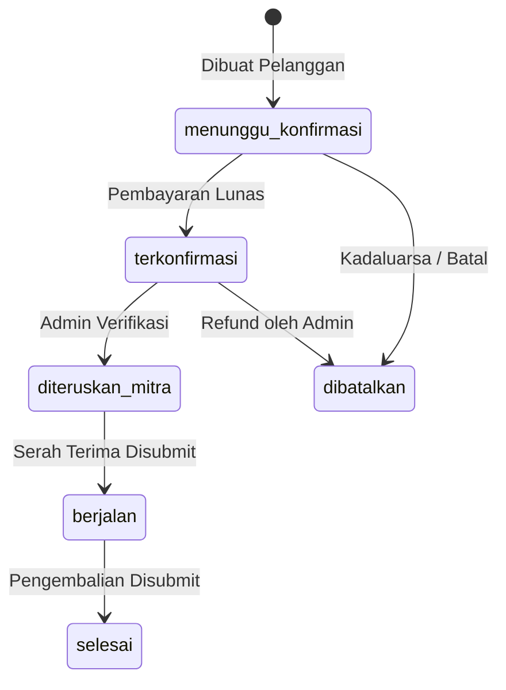

# BUSINESS RULES & OPERATIONAL SPECIFICATIONS
**Portal Mitra RentalinAja (Multi-Tenant Partner System)**

---

## 1. Multi-Tenant Data Isolation
Setiap mitra bisnis rental kendaraan di RentalinAja beroperasi secara mandiri:
1. **Query Boundary**: Setiap pemanggilan API dan pembacaan state mewajibkan filter `mitraId`.
2. **Access Control**: Tidak ada endpoint atau halaman yang memperbolehkan Mitra A melihat, mengubah, atau menghapus kendaraan, transaksi sewa, data pelanggan, atau catatan keuangan milik Mitra B.
3. **URL Parameter Protection**: Jika seorang pengguna dari Mitra B memasukkan URL `/vehicles/v-01` (di mana `v-01` adalah armada milik Mitra A), sistem mock dan backend harus mengembalikan `404 Not Found` atau pesan isolasi "Akses Ditolak: Anda tidak memiliki otoritas atas armada ini".

---

## 2. Role-Based Access Control (RBAC) Matrix

Portal memiliki 2 tingkatan peran pengguna:

| Modul / Kemampuan | MITRA_OWNER | MITRA_STAFF (Default) | Catatan Izin Staff |
|---|---|---|---|
| **Overview / Dashboard** | Penuh | Operasional Saja | Angka omzet disensor jika tanpa `view_financials` |
| **Katalog Kendaraan** | Read / Write | Read / Write | Dikelola via permission `manage_vehicles` |
| **Ketersediaan Armada** | Read / Write | Read / Write | Dikelola via permission `manage_availability` |
| **Pesanan Penyewaan** | Read / Write | Read / Write | Dikelola via permission `manage_orders` |
| **Serah Terima Unit** | Read / Write | Read / Write | Dikelola via permission `process_handover` |
| **Pengembalian Unit** | Read / Write | Read / Write | Dikelola via permission `process_return` |
| **Jadwal Servis / Maintenance** | Read / Write | Read / Write | Dikelola via permission `manage_maintenance` |
| **Pencatatan Pengeluaran** | Read / Write | Write (Terbatas) | Dikelola via permission `manage_expenses` |
| **Rekap Pendapatan & Reimburse**| Penuh | **Ditolak** | Staff dilarang melihat struktur margin komisi |
| **Rekening Bank Pencairan** | Read / Write | **Ditolak** | Khusus pemilik bisnis untuk mencegah fraud |
| **Laporan Eksekutif Bisnis** | Penuh | **Ditolak** | Khusus owner |
| **Manajemen Tim & Hak Akses** | Read / Write | **Ditolak** | Khusus owner |
| **Profil Bisnis & Jam Operasional**| Read / Write | **Ditolak** | Khusus owner |

---

## 3. Siklus Hidup Pesanan (Booking Lifecycle)

### 3.1 Status Kesiapan Mitra (`partnerReadiness`)
Ketika pesanan berstatus `diteruskan_mitra`:
- **`pending`**: Unit belum diperiksa/dibersihkan.
- **`ready`**: Unit telah dicuci, bensin diperiksa, dan siap diserahterimakan kepada penyewa.
- **`issue_reported`**: Unit mengalami kendala (misal: servis belum selesai atau mogok), memicu pemberitahuan darurat kepada Customer Support / Super Admin platform untuk penugasan unit pengganti.

---

## 4. SOP Serah Terima (Handover) & Pengembalian (Return)

### 4.1 Serah Terima Unit
1. Petugas operasional memeriksa identitas penyewa (KTP/SIM asli).
2. Petugas menginput angka odometer aktual dan level bahan bakar (% BBM).
3. Melakukan cek fisik 360 derajat dan mendokumentasikan baret/cacat lama yang ada agar penyewa tidak dirugikan di kemudian hari.
4. Memastikan kelengkapan dokumen wajib: STNK Asli, Toolkit, Dongkrak, Ban Serep, Segitiga Pengaman, P3K.
5. Penyewa membubuhkan tanda tangan digital pada formulir serah terima.
6. Status pemesanan otomatis beralih menjadi `berjalan` dan status kendaraan menjadi `disewa`.

### 4.2 Pengembalian Unit
1. Petugas menginspeksi kembali odometer, level BBM, dan kebersihan kabin.
2. **Keterlambatan (Late Fee)**:
   - Toleransi keterlambatan adalah 30 menit.
   - Keterlambatan > 1 jam dikenakan biaya per jam sesuai tarif rental (atau 10% tarif harian per jam).
   - Keterlambatan > 4 jam dihitung sewa 1 hari penuh.
3. **Kekurangan Bahan Bakar (Fuel Fee)**:
   - Dihitung proporsional berdasarkan selisih kapasitas tangki x harga BBM per liter + biaya pengisian Rp 20.000.
4. **Kerusakan Baru (Damage Fee)**:
   - Kerusakan baru di luar berita acara serah terima dibebankan kepada penyewa atau diklaim dari uang jaminan (security deposit).
5. Status pemesanan beralih menjadi `selesai` dan armada kembali ke status `aktif`.

---

## 5. Kebijakan Keuangan & Reimbursement

### 5.1 Skema Komisi Platform
- Platform RentalinAja mengenakan biaya komisi tetap sebesar **10%** dari total tarif sewa dasar kotor (`totalGross`).
- Rumus Pendapatan Bersih Mitra:  
  $$\text{partnerNet} = \text{totalGross} - (\text{totalGross} \times 0.10)$$
- Biaya denda pengembalian (keterlambatan, kekurangan bensin, dan ganti rugi cacat fisik) **100% menjadi hak milik mitra**.

### 5.2 Aturan Reimbursement
1. Ketika pemesanan selesai, sistem otomatis menjadwalkan klaim reimbursement senilai `partnerNet` ke rekening utama mitra yang terdaftar.
2. Mitra **TIDAK MEMILIKI WEWENANG** mengubah status reimburse menjadi `dibayar`.
3. Mitra **TIDAK MENGUNGGAH** bukti pembayaran transfer.
4. Mitra bertindak sebagai penerima pasif yang dapat:
   - Melihat status reimburse (`belum_dibayar` / `dibayar`).
   - Melihat detail invoice dan nomor rekening tujuan.
   - Mengunduh / melihat bukti transfer yang telah diunggah oleh Super Admin platform setelah dana dicairkan.
