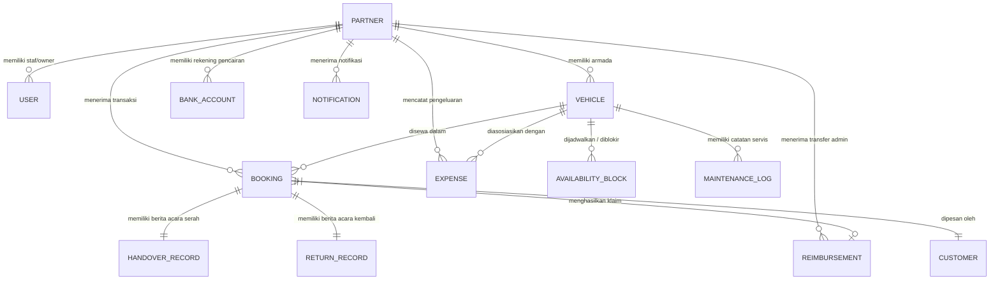

# DATA MODEL & ENTITY RELATIONSHIPS — RENTALINAJA MITRA PORTAL
**Enterprise Vehicle Rental Partner Management System**

---

## 1. Skema Diagram Konseptual (Entity-Relationship)



---

## 2. Definisi Entitas Utama

### 2.1 Partner (Mitra Rental)
Entitas dasar multi-tenancy. Semua query, data filtering, dan write mutations diisolasi berdasarkan `mitraId`.
```typescript
interface Partner {
  id: string;               // e.g. "mitra-01"
  name: string;             // e.g. "Nusantara Rent Yogyakarta"
  slug: string;             // e.g. "nusantara-rent-jogja"
  city: string;             // e.g. "Yogyakarta"
  address: string;
  phone: string;
  email: string;
  logo: string;
  rating: number;
  totalReviews: number;
  totalVehicles: number;
  joinedAt: string;
  verified: boolean;
  commissionRate: number;   // default 0.10 (10%)
  businessHours: {
    open: string;           // "07:00"
    close: string;          // "22:00"
  };
}
```

### 2.2 User & Permissions
Pengguna portal mitra dengan pemisahan Role `MITRA_OWNER` dan `MITRA_STAFF`.
```typescript
type MitraRole = 'MITRA_OWNER' | 'MITRA_STAFF';

type MitraPermission =
  | 'view_dashboard'
  | 'manage_vehicles'
  | 'manage_availability'
  | 'manage_orders'
  | 'process_handover'
  | 'process_return'
  | 'manage_maintenance'
  | 'view_financials'
  | 'manage_expenses'
  | 'manage_bank_accounts'
  | 'manage_team'
  | 'manage_business_profile';

interface MitraUser {
  id: string;
  mitraId: string;
  name: string;
  email: string;
  phone: string;
  role: MitraRole;
  avatar: string;
  permissions: MitraPermission[];
  active: boolean;
  createdAt: string;
}
```

### 2.3 Vehicle (Armada Kendaraan)
Unit mobil atau motor yang disewakan.
```typescript
type VehicleCategory = 'mobil' | 'motor';
type VehicleStatus = 'aktif' | 'disewa' | 'maintenance' | 'nonaktif';
type Transmission = 'matic' | 'manual';

interface Vehicle {
  id: string;
  mitraId: string;
  name: string;
  category: VehicleCategory;
  type: string;             // MPV, SUV, City Car, Scooter, Sport
  transmission: Transmission;
  seats: number;
  luggage: number;
  fuel: string;
  year: number;
  plateNumber: string;
  pricePerDay: number;
  securityDeposit: number;
  status: VehicleStatus;
  images: string[];
  features: string[];
  rules: string[];
  location: string;
  odometer: number;
  createdAt: string;
}
```

### 2.4 Booking (Penyewaan)
Transaksi penyewaan yang masuk dari platform customer.
```typescript
type BookingStatus =
  | 'menunggu_konfirmasi'
  | 'terkonfirmasi'
  | 'diteruskan_mitra'
  | 'berjalan'
  | 'selesai'
  | 'dibatalkan';

type PartnerReadiness = 'pending' | 'ready' | 'issue_reported';

interface Booking {
  id: string;
  bookingCode: string;       // e.g. "RN-2611-0012"
  mitraId: string;
  vehicleId: string;
  customerId: string;
  startDate: string;         // YYYY-MM-DD
  endDate: string;           // YYYY-MM-DD
  durationDays: number;
  dailyPrice: number;
  totalGross: number;        // dailyPrice * durationDays
  platformFee: number;       // totalGross * 0.10
  partnerNet: number;        // totalGross - platformFee
  deliveryFee?: number;
  status: BookingStatus;
  paymentStatus: 'belum_dibayar' | 'lunas' | 'refunded';
  partnerReadiness: PartnerReadiness;
  partnerNotes?: string;
  withDriver: boolean;
  pickupLocation: string;
  returnLocation: string;
  createdAt: string;
}
```

### 2.5 Handover & Return Record (Serah Terima & Pengembalian)
Berita acara digital dengan inspeksi kondisi kendaraan.
```typescript
interface HandoverRecord {
  id: string;
  bookingId: string;
  mitraId: string;
  vehicleId: string;
  officerName: string;
  handoverDate: string;
  odometer: number;
  fuelLevel: number;        // Persentase 0-100%
  cleanliness: 'sangat_bersih' | 'cukup_bersih' | 'kotor';
  checklist: {
    stnk: boolean;
    kunciCadangan: boolean;
    dongkrak: boolean;
    banSerep: boolean;
    p3k: boolean;
    segitigaPengaman: boolean;
  };
  damages: Array<{ area: string; description: string; photo?: string }>;
  customerSignature: string;
  notes?: string;
  submittedAt: string;
}

interface ReturnRecord {
  id: string;
  bookingId: string;
  mitraId: string;
  vehicleId: string;
  officerName: string;
  returnDate: string;
  odometer: number;
  fuelLevel: number;
  cleanliness: 'sangat_bersih' | 'cukup_bersih' | 'kotor';
  lateHours: number;
  lateFee: number;
  fuelFee: number;
  damageFee: number;
  cleaningFee: number;
  totalFine: number;
  notes?: string;
  submittedAt: string;
}
```

### 2.6 Reimbursement (Pencairan Dana dari Admin)
Catatan pencairan hak mitra dari sistem pusat.
```typescript
type ReimbursementStatus = 'belum_dibayar' | 'dibayar';

interface Reimbursement {
  id: string;
  reimburseCode: string;     // e.g. "RMB-2026-081"
  mitraId: string;
  bookingId: string;
  amount: number;            // partnerNet
  bankAccountId: string;
  bankName: string;
  accountNumber: string;
  accountHolder: string;
  status: ReimbursementStatus;
  transferProofUrl?: string; // Diisi oleh Super Admin platform
  paidAt?: string;           // Diisi oleh Super Admin platform
  adminNotes?: string;
  createdAt: string;
}
```
